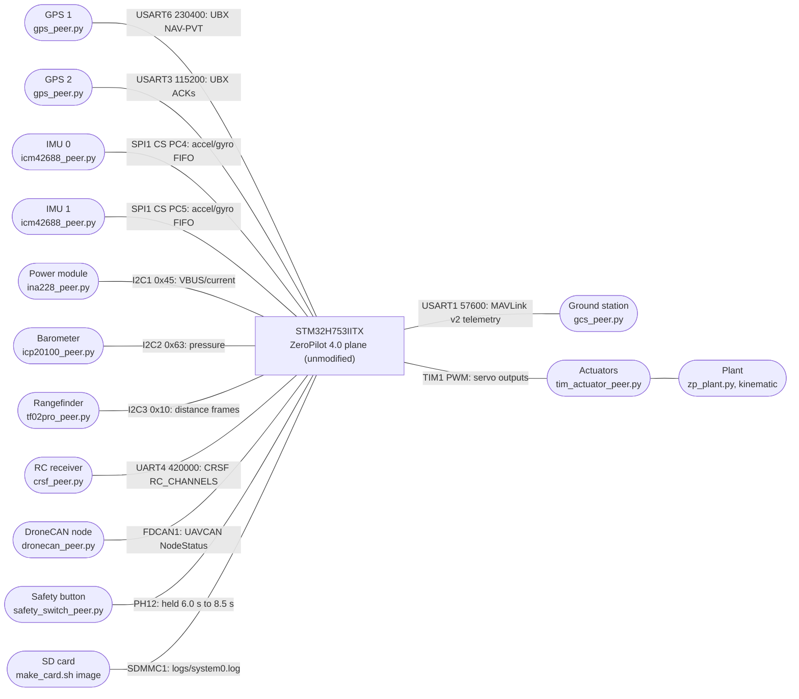

# ZeroPilot 4.0

> **This fork:** [`sim/`](sim/README.md) runs this firmware on a simulated STM32H753 with every sensor,
> the SD card and a ground station attached, no hardware needed.

Custom flight controller autopilot system by WARG (Waterloo Aerial Robotics Group).

**Documentation**: https://uwarg-docs.atlassian.net/wiki/spaces/ZP/pages/2668101634/ZeroPilot4.0+Design

## Run it in the simulator

```sh
sim/build.sh    # once, separate step: builds the plane firmware
./demo          # boots it on the simulated STM32H753 and prints the decoded MAVLink (about 70 s wall for 20 virtual s)
```




The firmware is the unmodified plane build of these sources, running FreeRTOS on the simulated STM32H753IITX.
The GPS receivers, IMUs, barometer, power module, rangefinder, RC receiver, DroneCAN node, safety button, SD card,
ground station and servo outputs are Python peers in `sim/`, modelled at transaction level (the bytes on each bus,
not electrical behaviour). The plant is kinematic, so there is no aerodynamics. `sim` is Simantic's proprietary
simulator, not open source; install it with `curl -fsSL https://simantic.com/install | sh` (0.10.0 or newer).
Also needed: the Arm GNU toolchain, `ninja`, `mtools` and cmake 3.x. Known gap: the barometer reads 0.0 hPa in
this run (`SCALED_PRESSURE`), listed in [`sim/README.md`](sim/README.md).

## Repo Setup

Clone the repository and initialize submodules:

```bash
git clone https://github.com/UWARG/efs-zeropilot-4.0.git
cd efs-zeropilot-4.0
git submodule update --init --recursive
```

## Project Structure

```
zeropilot4.0/               # Core autopilot library
├── src/                    # Manager implementations
│   ├── attitude_manager/   # Flight control & stabilization
│   ├── telemetry_manager/  # MAVLink communication
│   └── system_manager/     # System-level tasks
├── include/                # Headers & driver interfaces
└── tests/                  # Unit tests (GoogleTest)

stm32h753iitx/              # STM32H753 hardware target
stm32l552xx/                # STM32L552 hardware target
zp_sitl/                    # Software-in-the-Loop simulation
external/                   # Third-party dependencies (MAVLink)
```

## Building

### Hardware Build

Build for STM32H753 or STM32L552 can be done via STM32CubeIDE.

Select Debug/Release-plane for plane build and Debug/Release-quad for quadcopter build.

### Unit Tests

```bash
cd zeropilot4.0/tests
./testbuild.bash -c -v plane    # Clean build for plane
./testbuild.bash -c -v quad     # Clean build for quadcopter
./build/gtestzeropilot4.0       # Run tests
```

**Requirements**: GoogleTest, GoogleMock

### SITL Simulation

See [zp_sitl/README.md](zp_sitl/README.md) for details.

## Development

### Linting

```bash
cd zeropilot4.0
./lint.bash -v plane   # Linting for plane
./lint.bash -v quad    # Linting for quadcopter
```

### Debugging Unit Tests (VS Code)

Create `.vscode/launch.json`:

```json
{
  "version": "0.2.0",
  "configurations": [{
    "name": "GTest Debug",
    "type": "cppdbg",
    "request": "launch",
    "program": "${workspaceFolder}/zeropilot4.0/tests/build/gtestzeropilot4.0",
    "args": ["--gtest_filter=*"],
    "cwd": "${workspaceFolder}",
    "MIMode": "gdb",
    "miDebuggerPath": "/usr/bin/gdb",
    "setupCommands": [{
      "description": "Enable pretty-printing for gdb",
      "text": "-enable-pretty-printing",
      "ignoreFailures": true
    }]
  }]
}
```

Note: Use --gtest_filter to run a specific or subset of tests: https://google.github.io/googletest/advanced.html#running-a-subset-of-the-tests

## CI/CD

GitHub Actions run on every push/PR:
- Hardware compilation (both targets, Debug/Release)
- Unit tests
- SITL build verification
- Code linting

## Hardware Targets

- **STM32H753IIT6**: Primary flight controller (480MHz, 2MB Flash)
- **STM32L552ZET6Q**: Secondary target (110MHz, 512KB Flash)

Both use FreeRTOS with custom driver interfaces for portability.
