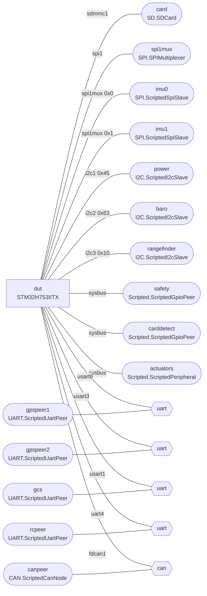

# ZeroPilot 4.0 in a simulator

The plane firmware (`stm32h753iitx`, FreeRTOS) running on a simulated STM32H753IITX with the parts around
it attached as Python models: two GPS receivers, two IMUs, a barometer, a power module, a rangefinder, a
CRSF receiver, a DroneCAN node, a safety button, an SD card and a ground station on the telemetry radio.
No board, no bench. Backend: Simantic's `sim` 0.10.0 (build f219eb31), which runs the H753 on the
**pyrite** engine (Rust, in-process, JIT on by default). Everything below was run on 2026-11-15.


*Kinematic-plant run, 20 virtual s: the MAVLink the firmware sends on USART1, decoded by `view.py` (776
CRC-valid frames), and the card after the run, with the firmware's own `logs/system0.log` on it.*


*Same run: the firmware's ATTITUDE (pitch moves from 0 to about -9 deg, the IMU peer's tilt, and back toward -6), GPS_RAW_INT fix and
SERVO_OUTPUT_RAW. All read back from the MAVLink on USART1, none from the peers' own state.*


*JSBSim run, 30 virtual s: attitude leaves level flight from about 10 s (`screenshots/decoded_jsbsim.png` has the table).*

## What runs

| Part | Model | Bus |
| --- | --- | --- |
| Flight controller | `stm32h753iitx` plane build, unmodified sources | STM32H753IITX |
| GPS 1, GPS 2 | u-blox M9/M10 (UBX, ACKs the configuration, NAV-PVT at the rate the driver programs), `gps_peer.py` | USART6 230400, USART3 115200 |
| IMU 0, IMU 1 | ICM-42688-P, `icm42688_peer.py` | SPI1, CS PC4 / PC5 |
| Power module | INA228, `ina228_peer.py` | I2C1 0x45 |
| Barometer | ICP-20100, `icp20100_peer.py` | I2C2 0x63 |
| Rangefinder | TF02-Pro, `tf02pro_peer.py` | I2C3 0x10 |
| RC receiver | CRSF, `crsf_peer.py` | UART4 420000 |
| DroneCAN node | anonymous node-id allocation, then NodeStatus, `dronecan_peer.py` | FDCAN1 |
| Safety button | held 6.0 s to 8.5 s, `safety_switch_peer.py` | PH12 |
| SD card | the sim's SD card model on a blank FAT16 image, written back to `out/card.img`; `card_detect_peer.py` pulls the card-detect pin PA15 low | SDMMC1 |
| Servo outputs | `tim_actuator_peer.py` reads TIM1 PWM and drives the plant (`zp_plant.py`, or `zp_jsbsim_plant.py` with JSBSim) | TIM1 |
| Ground station | `gcs_peer.py` frames MAVLink v2, checks every CRC with the message's CRC_EXTRA | USART1 57600 |

The scenario, as `sim graph --scenario sim/scenario.yaml` prints it. Rounded boxes are the modelled parts,
hexagons are the shared UART and CAN media:



## Configurations tried

Each row is one run of `sim/run.sh` on `sim` 0.10.0 (f219eb31), pyrite, 2026-11-15.

| Configuration | Virtual s | Wall s | Result |
| --- | --- | --- | --- |
| Kinematic plant, blank SD card | 20 | 41 | PASS: 776 CRC-valid MAVLink frames, 0 bad CRC; armed at 11 s after the safety button; `logs/system0.log` on the card |
| Same, card left unformatted of `logs/` (firmware creates it itself) | 20 | 41 | runs, but the card image has no `logs/` afterwards (see Gaps) |
| JSBSim `c172x` plant (`JSBSIM_SITE` set), blank SD card | 30 | 67 | PASS on the same assertions: 1336 CRC-valid frames, 0 bad. The aircraft moves (GPS 43.4723, -80.5449, 334 m to 43.4734, -80.5424, 236 m) but does not hold flight: ATTITUDE roll -31, pitch +36, yaw +60 deg at 30 s, sticks fixed and throttle at minimum (see Gaps) |

Not run: the quad build, a second flight mode, anything on real hardware. These are `unverified`.

## Run it

Needs the Arm GNU toolchain, `cmake`, `ninja`, `mtools` and Simantic's `sim` on PATH.

```
sim/build.sh                 # libzeropilot4.0.a, then the application link
sim/run.sh 20                # PASS or FAIL; decoded MAVLink in sim/out/view.txt
pip install matplotlib && python3 sim/screenshots.py sim/out/out.txt sim/out/view.txt sim/out/card.img "<caption>" sim/screenshots
```

`run.sh` asserts on the application output: every MAVLink message listed in it must have been decoded by
the ground-station peer from the firmware's own USART1 stream, no frame may fail its CRC, the heartbeat
must report armed, and the log file must exist on the card.

## Changes to the firmware

No source file is edited. This branch is `feature/driver/filesystem` (the SD driver, not yet in `main`)
plus two build-only commits from `feature/h753-cmake`, plus three lines in `stm32h753iitx/CMakeLists.txt`:

- **A command-line link for the application** (`stm32h753iitx/CMakeLists.txt`, from `feature/h753-cmake`).
  `hwbuild.bash` builds only `libzeropilot4.0.a`; the final link otherwise lives in STM32CubeIDE.
- **Three additions to it for the SD driver:** the `boardfiles/drivers/filesystem` include directory,
  `FatFs/src/option/ccsbcs.c` (`ff_convert`, `ff_wtoupper`) and `FATFS/Target/user_diskio_sdmmc.c`.

## Gaps

- **Blank card:** on a card with no `logs/` directory the firmware's own `f_mkdir("logs")` runs at 6.10 s
  and issues four block writes (`USER_SDMMC_write`, traced), but none of them reached the image file
  afterwards. Writes later in the run did (the log file's blocks). `make_card.sh` therefore creates
  `logs/` itself. Cause not investigated.
- **SCALED_PRESSURE reads 0.0 hPa:** all 69 frames in the 20 s run. The barometer peer does answer the
  firmware's 6-byte PRESS_DATA reads (363 in the run, raw bytes decoding to 100.4 kPa).
  `AttitudeManager` copies `baroData` into the message without looking at `readData()`'s return
  value, so frames sent on a tick with no new sample carry zeros. Traced on sim 0.10.1: the burst reads keep
  coming every ~40 ms after the kernel starts, and every SCALED_PRESSURE payload is zero past `time_ms`.
  This is a firmware bug, not a simulator gap.
- **JSBSim run does not fly a trimmed aircraft:** RC sticks are constant (throttle channel 1000) and the stock
  Cessna 172 is not this UAV's airframe, so the firmware's ATTITUDE shows it tumbling. That is the plant and the
  stick script, not a finding about the firmware. The firmware's servo outputs stayed at 1500/1490/1000/1500
  us throughout, so the loop is not closed in that run.
- **Fixed sensor values:** GPS position, pressure, rangefinder and RC sticks are constants. Only the
  IMU follows the plant. The kinematic plant has no aerodynamics.
- **Speed:** about 2 s of wall time per virtual second on this machine.
- **Card detect:** the card-detect pin is a part of the board, not the firmware's concern, but without
  `card_detect_peer.py` the firmware sees "no card" and never mounts.
